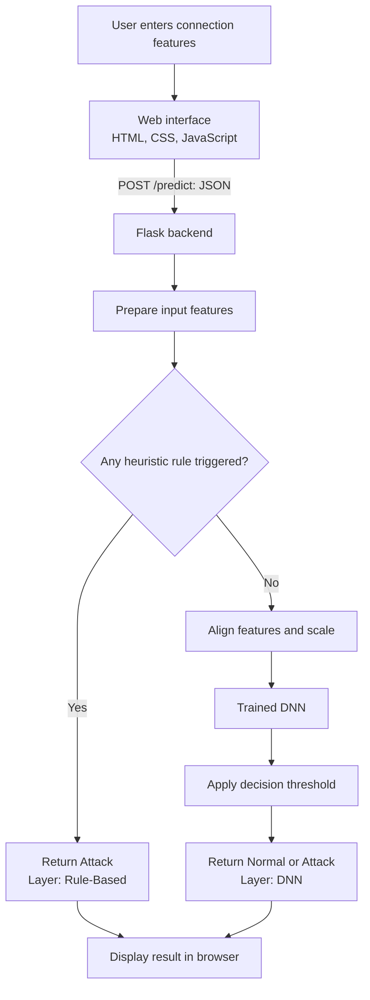
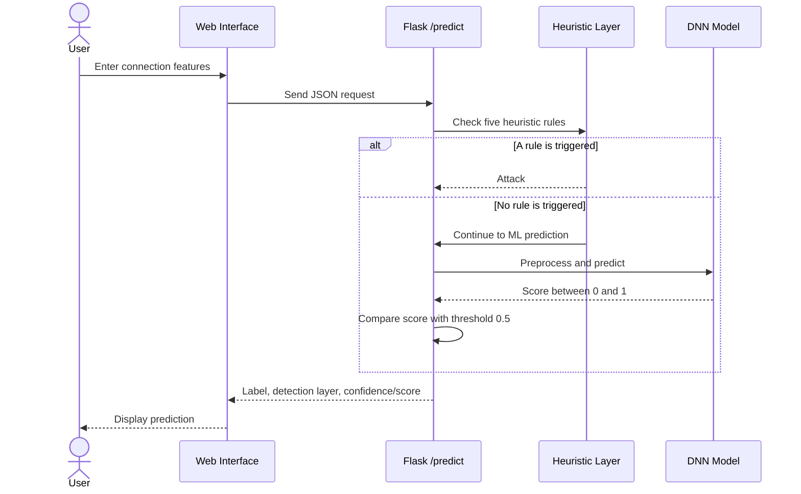
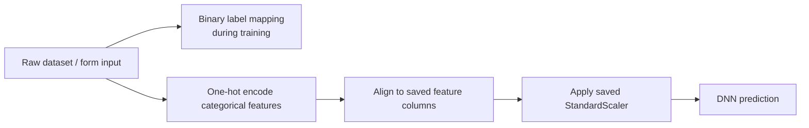
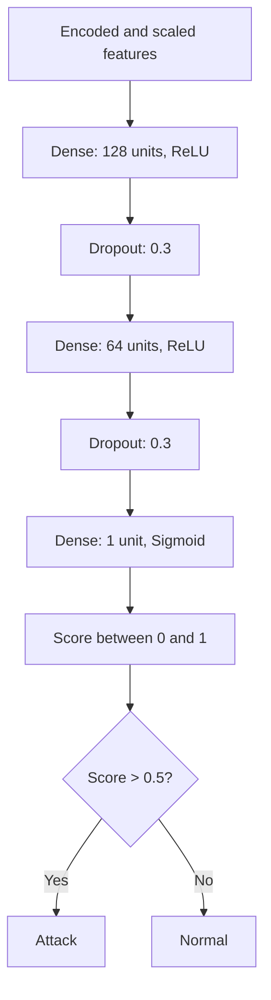

# Hybrid Intrusion Detection System for Cloud Security

**A prototype combining rule-based heuristics and a Deep Neural Network (DNN) to classify network-connection records as `Normal` or `Attack`.**

This project explores a two-layer approach to intrusion detection. Five manually defined heuristic rules check for selected suspicious patterns first. If no rule is triggered, a trained DNN classifies the connection. A Flask backend connects the detection pipeline to a browser-based interface.

> **Project status:** Academic prototype. Network features are entered through the web form; the application does **not** capture live packets or continuously monitor a real cloud network. The hybrid system's overall performance has not been separately benchmarked, so the model metrics below should not be interpreted as the accuracy of the complete hybrid pipeline.

## Contents

- [Overview](#overview)
- [Key features](#key-features)
- [Architecture and workflow](#architecture-and-workflow)
- [Detection logic](#detection-logic)
- [Datasets and experiments](#datasets-and-experiments)
- [Preprocessing pipeline](#preprocessing-pipeline)
- [Model architecture](#model-architecture)
- [Technology stack](#technology-stack)
- [Project structure](#project-structure)
- [Run locally](#run-locally)
- [Deployment](#deployment)
- [Evaluation and limitations](#evaluation-and-limitations)
- [Future improvements](#future-improvements)
- [Author](#author)

## Overview

Cloud-hosted applications and services can be exposed to threats such as denial-of-service activity, scanning, and unauthorized access attempts. Intrusion detection systems help identify network activity that may be malicious.

This project investigates a **hybrid detection design**:

1. **Heuristic layer:** checks the submitted connection features against five predefined rules.
2. **DNN layer:** if no heuristic rule fires, the preprocessed features are passed to the trained DNN for binary classification.

The result is returned to the web interface as either **Normal** or **Attack**, along with information about which layer produced the result.

### Project goals

- Explore how rule-based checks and machine learning can be combined.
- Train and evaluate machine-learning models on benchmark intrusion-detection datasets.
- Keep training-time and prediction-time preprocessing consistent.
- Expose the prototype through a simple Flask web application.
- Identify the work needed before a system like this could be evaluated on live network traffic.

## Key features

- Binary classification: `Normal` or `Attack`.
- Five manually defined heuristic checks.
- DNN-based prediction when no heuristic rule is triggered.
- Preprocessing for categorical features, feature alignment, and scaling.
- Flask backend with a browser-based HTML/CSS/JavaScript interface.
- Saved model and preprocessing artifacts loaded by the backend.
- Experiments with Random Forest, DNN, and BiLSTM models.

## Architecture and workflow

The following diagrams are written in Mermaid, which GitHub can render directly in a Markdown README. They are source diagrams rather than screenshots, so they remain easy to maintain.

### High-level architecture



### Request and prediction sequence



**Important:** the form accepts a single connection's features. The diagrams describe the implemented prototype, not an automated packet-capture pipeline.

## Detection logic

### Layer 1 — Rule-based heuristics

The first layer checks the raw input against five manually selected conditions. If any condition is triggered, the prototype returns `Attack` without asking the DNN to make the final decision for that request.

| Rule | Condition | Intended signal |
|---|---|---|
| R1 | `src_bytes == 0` | A connection with no source bytes; potentially unusual, but not necessarily malicious on its own. |
| R2 | `duration > 10000` seconds | An unusually long connection that may deserve investigation. |
| R3 | `dst_bytes > 5000000` bytes | A very large destination-byte count that may warrant review. |
| R4 | `protocol_type == "icmp"` and `flag == "S0"` | A manually specified protocol/flag combination intended as a suspicious-pattern check. |
| R5 | `count > 500` | A high connection count that may indicate scanning or flooding activity. |

These rules are **heuristics, not proof of an attack**. Legitimate traffic can trigger a rule, and an attack may not trigger any of them. The thresholds were adjusted during testing; they should not be treated as universally valid security thresholds. In particular, the meaning and compatibility of the `flag` field should be verified against the dataset schema before relying on R4.

### Layer 2 — Deep Neural Network

If none of the heuristic rules fires, the backend preprocesses the submitted features and passes them to the trained DNN. The model produces a sigmoid score between 0 and 1. The prototype uses a threshold of `0.5`:

- Score greater than `0.5` → `Attack`
- Score less than or equal to `0.5` → `Normal`

The score is used as a model confidence-like output by the application; it should **not** be described as a calibrated probability unless calibration has been evaluated.

## Datasets and experiments

Two benchmark datasets were used during the project, for different experiments.

| Dataset | Use in this project | Notes |
|---|---|---|
| **NSL-KDD** | Main dataset for Random Forest and DNN | A cleaned version of KDD Cup 1999 with duplicate records reduced; commonly used for intrusion-detection research. |
| **UNSW-NB15** | Experimental BiLSTM run | A more modern benchmark containing multiple attack categories and a different feature schema from NSL-KDD. |

The dataset schemas differ. A model trained on one dataset cannot simply be substituted into another dataset's prediction pipeline without matching the expected features and preprocessing.

### Reported model results

The following are the approximate results reported for the model experiments on their respective test splits:

| Model | Dataset | Approx. accuracy | Role |
|---|---|---:|---|
| Random Forest | NSL-KDD | 80% | Baseline experiment |
| Deep Neural Network (DNN) | NSL-KDD | 79% | Final ML model in the prototype |
| BiLSTM | UNSW-NB15 | 78% | Experimental model |

These results are approximate and come from experiments on different dataset splits, so they are **not a perfectly controlled, apples-to-apples comparison**. The complete hybrid system (heuristics plus DNN) was not separately evaluated with its own metrics.

### Why use the DNN in the final prototype?

Random Forest performed slightly better in the reported NSL-KDD experiment. The DNN was retained as the final machine-learning model because it fit the intended deep-learning implementation and the existing Flask prediction pipeline. The decision does not imply that DNN is universally better than Random Forest; the most suitable model depends on the data, evaluation criteria, and deployment constraints.

## Preprocessing pipeline

Consistent preprocessing is essential because the model expects the same feature representation during training and prediction.

1. **Binary labels:** `normal` is mapped to `0`; attack labels are mapped to `1`.
2. **Categorical encoding:** categorical fields such as `protocol_type`, `service`, and `flag` are one-hot encoded.
3. **Feature alignment:** the input is reindexed to the saved training feature-column list, with missing encoded columns filled with `0`.
4. **Scaling:** `StandardScaler` is fitted on the training data and reused for prediction. It should not be refitted on individual inference inputs.
5. **Saved artifacts:** the trained model, scaler, and feature-column reference are saved and loaded by the backend.



The label-mapping step applies to training labels; inference-time form input contains features, not a known target label.

## Model architecture

The final DNN is a feed-forward neural network for binary classification:



Reported training configuration included the Adam optimizer, binary cross-entropy loss, 10 epochs, batch size 64, a validation split, and balanced class weights.

## Technology stack

| Area | Tools |
|---|---|
| Language | Python |
| Web backend | Flask |
| Machine learning | TensorFlow / Keras, scikit-learn |
| Data processing | Pandas, NumPy |
| Model/artifact persistence | Joblib and saved Keras model |
| Frontend | HTML, CSS, JavaScript |
| Cloud deployment tested | AWS EC2 (Ubuntu, `t3.micro`) |
| Web server/reverse proxy | Nginx |
| Version control | Git and GitHub |

## Project structure

The exact repository layout may vary. The main implementation includes the following kinds of files and artifacts:

```text
.
├── app.py                    # Flask application and /predict endpoint
├── requirements.txt          # Python dependencies
├── prepare_data.py           # Dataset preprocessing (if included in the repo)
├── train_model.py            # Model training (if included in the repo)
├── templates/                # HTML templates, if using Flask templates
├── static/                   # CSS and JavaScript assets, if present
├── dnn_model.h5              # Saved DNN model (generated by training)
├── scaler.pkl                # Saved fitted scaler
└── feature_columns.pkl       # Saved feature-column order
```

This is an illustrative layout, not a guarantee that every listed file is committed in the current repository. Model files may need to be generated by the training workflow or supplied separately.

## Run locally

The commands below are a general setup outline. Check the actual filenames and dependency versions in the repository before running them.

### 1. Clone the repository

```bash
git clone https://github.com/tanimamishra/ml-cloud-security-pbl4.git
cd ml-cloud-security-pbl4
```

### 2. Create and activate a virtual environment

**Windows (PowerShell):**

```powershell
python -m venv .venv
.\.venv\Scripts\Activate.ps1
```

**Linux / macOS:**

```bash
python3 -m venv .venv
source .venv/bin/activate
```

### 3. Install dependencies

```bash
pip install -r requirements.txt
```

### 4. Prepare model artifacts

If the trained model and preprocessing artifacts are not included in the repository, run the available preprocessing and training scripts according to their instructions. The application needs the trained DNN, saved scaler, and expected feature-column list.

Do not commit large datasets, credentials, or sensitive information to the repository. Follow the dataset's license and access conditions when obtaining the data.

### 5. Start the application

```bash
python app.py
```

Open the local address printed by Flask in your browser. The app's `/predict` endpoint accepts the feature payload sent by the frontend. Confirm the actual expected fields in `app.py` before sending requests manually.

> Flask's built-in development server is suitable for local testing, not a production deployment.

## Deployment

The prototype was also deployed on an AWS EC2 `t3.micro` Ubuntu instance. The deployment process included cloning the repository, creating a Python virtual environment, installing dependencies, running the Flask app, configuring Nginx as a reverse proxy, and accessing the site through the instance's public IP.

The EC2 instance is currently stopped. This should be considered a demonstration deployment, not a claim of production readiness. A production-oriented deployment would need, among other things, a production WSGI server such as Gunicorn, process supervision, HTTPS, hardened access controls, logging, and operational monitoring.

## Evaluation and limitations

Known limitations of the current prototype include:

- **No live packet capture:** features are entered manually through the interface.
- **Binary output only:** the model reports `Normal` or `Attack`; it does not identify the attack family.
- **Manually selected rules:** thresholds may create false positives or miss attacks.
- **Dataset-to-real-world gap:** performance on benchmark records does not establish performance on current cloud traffic.
- **No separate hybrid-system benchmark:** reported accuracy figures are for individual model experiments, not for the complete heuristic-plus-DNN pipeline.
- **Different feature schemas:** NSL-KDD and UNSW-NB15 require their own compatible preprocessing and model inputs.
- **Prototype deployment:** the existing deployment is not a production-hardened security service.

For an intrusion detection system, accuracy alone is not enough. Precision, recall, F1-score, false-positive rate, and especially missed-attack behavior should also be examined.

## Future improvements

1. Integrate authorized live packet capture and automated feature extraction, for example with Scapy or PyShark, in a controlled test environment.
2. Evaluate the complete hybrid system on a held-out test set and report confusion matrix, precision, recall, F1-score, and false-positive rate.
3. Tune heuristic rules using validation data and document the trade-offs between missed attacks and false alarms.
4. Add multi-class classification to identify attack categories rather than only `Normal` or `Attack`.
5. Test robustness against data drift and traffic patterns that differ from the training datasets.
6. Improve deployment hardening with a production WSGI server, HTTPS, monitoring, and secure configuration.
7. Explore integration with security monitoring or alerting platforms after the detection pipeline has been evaluated.

## Research work

The project includes a literature review and experimental work on machine-learning-based intrusion detection. A research paper is being prepared; it should not be described as submitted, accepted, or published unless that status changes.

## Author

**Tanima Mishra**  
B.Tech, Computer Science and Engineering (Cloud Computing)  
Manipal University Jaipur

- GitHub: [tanimamishra](https://github.com/tanimamishra)

---

If you use or adapt this project, please verify the dataset licenses, review the heuristic rules for your use case, and evaluate the complete system before relying on it for security decisions.
